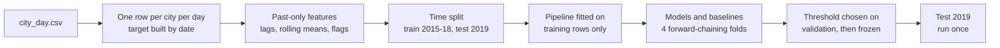

<div align="center">

# AirWarn

### Next-day unhealthy air warning for Indian cities

*Can past air-quality readings tell us, a day ahead, that a city's AQI will be above 200 ("Poor" or worse), and do it better than "tomorrow will be like today"?*

[](https://ayushi2577.github.io/AirWarn/)
[](https://github.com/ayushi2577/AirWarn)


**Ayushi Agrawal** (26120002) &nbsp;·&nbsp; **Pranjali Budhe** (26120006)

[Website](https://ayushi2577.github.io/AirWarn/) · [Results](#results) · [Quick start](#quick-start) · [Reproduce](#reproduce-everything) · [Limitations](#limitations) · [Contributions](#contributions)

</div>

---

## Contents

1. [The question](#the-question)
2. [At a glance](#at-a-glance)
3. [Data](#data)
4. [How it works](#how-it-works)
5. [Split and validation](#split-and-validation)
6. [Preprocessing](#preprocessing)
7. [Methods](#methods)
8. [Results](#results)
9. [Quick start](#quick-start)
10. [Reproduce everything](#reproduce-everything)
11. [Repository layout](#repository-layout)
12. [Limitations](#limitations)
13. [Contributions](#contributions)
14. [AI assistance and credits](#ai-assistance-and-credits)

---

## The question

Using a city's air-quality readings **up to the end of day *t***, can we predict whether the AQI on day ***t+1*** will be **above 200** ("Poor", "Very Poor" or "Severe" on the CPCB scale), better than the baseline *"tomorrow will be like today"* (persistence)?

| | |
|---|---|
| **Task** | Binary classification |
| **One row** | One city on one day *t* |
| **Target** | `poor_tomorrow = 1` if the city's AQI on day *t+1* is above 200 (the official CPCB boundary, never tuned) |
| **Prediction time** | End of day *t*, using only day *t* and earlier |
| **Claim** | Prediction for these 26 monitored cities in 2015 to mid-2020. **Not** causation, not other cities, not today's conditions |

The target is built by **date**, not by "next row", so a missing day can never pass as "tomorrow".

## At a glance

| | |
|---|---|
| **Rows used** | 24,343 (6,330 positive, 26.0%) |
| **Cities** | 26 (18 seen in training, 8 new) |
| **Period** | 2015-01-01 to 2020-07-01 |
| **Main metric** | PR-AUC (only 26% of days are positive) |
| **Chosen model** | Logistic regression (by a rule written before the results) |
| **Honest summary** | A real but modest gain over a strong persistence baseline. It mostly follows today's AQI and misses most sudden clean-to-bad jumps (about 10% caught), probably because there is no weather data |

## Data

- **Source:** Kaggle, *Air Quality Data in India (2015-2020)*, [`rohanrao/air-quality-data-in-india`](https://www.kaggle.com/datasets/rohanrao/air-quality-data-in-india), file `city_day.csv`.
- **Original source:** Central Pollution Control Board (CPCB), Government of India.
- **Size:** 29,531 city-days, 26 cities, 16 columns.
- **Licence:** CC0 (public domain) on the Kaggle page. See `LICENSE.md`.
- **Known issues:** blanks (Xylene 61%, PM10 38%, NH3 35%), pollutants never measured in some cities, uneven city coverage, AQI computed by the uploader and not capped at 500, no weather data.

> **The raw data is not included in this repository.**

### Getting the data

1. Log in to Kaggle and download `city_day.csv` from the dataset page, or run
   `kaggle datasets download -d rohanrao/air-quality-data-in-india`
2. Place the file at `data/raw/city_day.csv`.
3. Never commit `kaggle.json` or the raw data (both are in `.gitignore`).

## How it works



## Split and validation

The split is fixed **before modelling**, is by **time**, and is never shuffled. Embargo days are dropped because their label (tomorrow's AQI) falls in the next period.

| Part | Dates | Rows | Positives |
|---|---|---|---|
| Train | 2015-01-01 to 2018-12-30 | 13,024 | 4,300 |
| **Test (used once)** | 2019-01-01 to 2019-12-30 | 6,946 | 1,567 |
| 2020 pre-lockdown | 2020-01-01 to 2020-03-23 | 1,941 | 409 |
| 2020 lockdown and unlock | 2020-03-25 to 2020-07-01 | 2,369 | 32 |

Embargo days: `2018-12-31`, `2019-12-31`, `2020-03-24`.

**Validation: four forward-chaining, date-based folds inside 2015-2018** (each trains on all earlier dates). We built them from dates because `TimeSeriesSplit` splits by row position and would mix cities.

| Fold | Train up to | Validate on | Positives |
|---|---|---|---|
| 1 | 2016-12-30 | 2017-01-01 to 2017-06-30 | 506 |
| 2 | 2017-06-29 | 2017-07-01 to 2017-12-31 | 533 |
| 3 | 2017-12-30 | 2018-01-01 to 2018-06-30 | 797 |
| 4 | 2018-06-29 | 2018-07-01 to 2018-12-30 | 785 |

**Seen cities:** 18 (have rows in 2015-2018). **New cities:** 8 (never in training), reported separately.

## Preprocessing

| Stage | What it does | Fitted on |
|---|---|---|
| `features.py` | Explicit calendar, drop Xylene, forward-fill within a city for at most 3 days, "was missing" flags (PM10, NH3, Toluene, Benzene), lags (1, 2, 3, 7 days), 3 and 7-day rolling means for AQI, PM2.5 and PM10, change since yesterday, month, day of week, season | Nothing learned, past values only |
| `pipeline.py` | Cap at the 99.5th percentile, median imputation, standard scaling, one-hot encoding of city, season, month and day of week (`handle_unknown="ignore"`, so unseen cities get all-zero columns) | **Training rows only**, inside a scikit-learn `Pipeline` |
| `tests/test_no_future.py` | Rebuilds the features after deleting all data past a cutoff and checks that nothing changes | Leakage test |

## Methods

- **Baselines:** majority class, persistence (AQI > 200 today), and a tuned single feature (AQI > c).
- **Models:** logistic regression (chosen), linear SVM, exact RBF SVM. One RBF fit took about 3 seconds, so no Nystroem approximation. Platt scaling turns SVM scores into probabilities (fitted on pooled validation scores only).
- **Model-choice rule, written before the results:** choose logistic regression unless the best SVM is better in most folds and clearly better on average. Result: logistic regression chosen.
- **Gradient check:** the cross-entropy loss and gradient were derived by hand and a NumPy gradient descent was compared with scikit-learn (`src/gradient_check.py`): objective 0.167417 vs 0.167425, and 99.89% identical yes/no decisions.
- **Threshold:** highest precision with recall at least 80% on pooled validation, then **frozen** in `outputs/results/frozen_settings.json`. Never re-tuned on the test.
- **Metrics:** PR-AUC (main), precision, recall, F1, ROC-AUC. Uncertainty: block bootstrap over weeks.

## Results

### Headline: 2019 test, 18 seen cities

| Model | Precision | Recall | PR-AUC |
|---|---|---|---|
| **Logistic regression** | **0.940** | 0.780 | **0.958** |
| RBF SVM (Platt) | 0.941 | 0.783 | 0.959 |
| Persistence | 0.847 | 0.849 | 0.754 |
| Tuned single feature (AQI > 234, cutoff frozen on validation) | 0.914 | 0.749 | 0.934 |

### What this means

- **At persistence's own recall (0.849),** logistic regression reached precision **0.913 vs 0.847**, a gain of **+6.7 points** (95% interval +5.0 to +8.6). This check was run after seeing the test and was not used to change anything.
- **Most of the signal is today's AQI.** The tuned single-feature rule is close behind (PR-AUC 0.934), so the extra features add a small, consistent gain.
- **Persistence is right on 92.8% of rows.** The remaining 1,748 *change days* (7.2%) are where a model can add value. Logistic regression catches about **10%** of clean-to-bad flips; persistence catches 0%.
- **New cities:** precision stays high (0.92) but recall falls to 0.54.
- **2020 stress test:** recall falls to 0.69 even before lockdown. The lockdown period has only 32 positives, so it is flagged as unreliable.

Full tables, per-city results, the ablation, calibration, error analysis and the threshold explorer are on the **[website](https://ayushi2577.github.io/AirWarn/)** and in `outputs/results/`.

## Quick start

```bash
git clone https://github.com/ayushi2577/AirWarn.git
cd AirWarn

python -m venv venv
venv\Scripts\activate            # Windows   (Mac/Linux: source venv/bin/activate)
pip install -r requirements.txt

# put city_day.csv in data/raw/ (see "Getting the data"), then:
python src/data.py               # counts check: 24,343 rows, 6,330 positives
python -m pytest tests -q        # no-future-leakage test
```

## Reproduce everything

Run from the project root, in this order (all scripts are in `src/`):

```bash
python src/explore_data.py --csv data/raw/city_day.csv   # data summary and plots (outputs/data_summary.md)
python src/data.py                  # counts check
python src/splits.py                # split and fold counts
python -m pytest tests -q           # no-future-leakage test
python src/baseline.py              # baselines on validation folds
python src/models.py                # logistic regression vs baseline
python src/gradient_check.py        # hand-written gradient descent vs scikit-learn
python src/run_svm.py               # SVM tuning grids
python src/compare.py               # model-choice rule, Platt scaling
python src/run_eval.py              # threshold sweep, freezes thresholds and the single-feature cutoff
python src/run_bootstrap.py         # confidence intervals
python src/run_tables.py            # persistence comparison, per-city, reliability
python src/run_regularization.py    # L1 vs L2
python src/run_ablation.py          # feature-group ablation
python src/run_errors.py            # error analysis
```

**Final test: run once**, after the frozen settings exist and without changing them:

```bash
python src/run_final_test.py
python src/run_equal_recall.py
python src/export_site_data.py      # writes docs/data/*.json for the website
```

Optional EDA notebook: `pip install jupyter`, then open `notebooks/01_eda.ipynb` (outputs are already saved in it).

## Repository layout

```text
AirWarn/
├── docs/            the website (GitHub Pages serves this folder)
│   └── data/        precomputed JSON used by the charts and the threshold explorer
├── src/             code: data, splits, features, pipeline, evaluate, models, run_* scripts
├── tests/           no-future-leakage test
├── notebooks/       01_eda.ipynb (data exploration)
├── outputs/         figures, plots and result tables (outputs/results/)
├── data/raw/        city_day.csv goes here (not committed)
├── AI_DISCLOSURE.md
├── LICENSE.md
└── requirements.txt
```

## Limitations

- **No weather data.** Wind and rain strongly affect pollution, so sudden clean-to-bad flips are mostly missed.
- **Mostly follows today's AQI.** The gain over persistence is real but modest.
- **Selection bias.** A row exists only when AQI was reported on both days.
- **Coverage.** 26 monitored cities only. Stations do not represent whole cities, and 8 cities never appear in training.
- **Dataset AQI** was computed by the uploader and is uncapped. Our target (above 200) is not affected by the cap.
- **Threshold drift.** Bad days were 33% of training but 22.6% of 2019.
- **Weaker transfer to unseen cities**, and the lockdown period has only 32 positives.
- **Correlated days.** The effective sample size is smaller than the row count.

This project **predicts; it does not explain causes**, and it is not shown to work for other cities or for today.

## Contributions

We worked as a pair and shared the work equally.

| Name | Work done |
|---|---|
| **Ayushi Agrawal** (26120002) | Problem and target, features, baselines, logistic regression, splits and folds, website |
| **Pranjali Budhe** (26120006) | Data checks and EDA, preprocessing and leakage test, SVMs, thresholds and final test, errors, README |

## AI assistance and credits

We used ChatGPT to explore and compare options, and Claude for coding, debugging and drafting text. All decisions were ours, and we ran every script and checked the results. Full details are in [`AI_DISCLOSURE.md`](AI_DISCLOSURE.md).

**Data:** Central Pollution Control Board, Government of India, via Rohan Rao's Kaggle dataset (CC0).
**Libraries:** pandas, NumPy, scikit-learn, Matplotlib, SciPy, pytest, pyarrow, joblib and Chart.js (website).